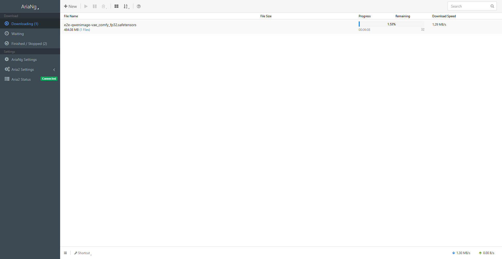

# 6+6: getting 12 Mbit/s out of a 6 Mbit/s connection

My home connection is capped by the ISP at 6 Mbit/s. This is the story of how I found a second, independent 6 Mbit/s path and made one download use both at the same time, with **sing-box**, **HAProxy** and **aria2**.

Result: a single file downloads at **10-12 Mbit/s** on a line that is officially limited to 6. The screenshot below shows 1.3 MB/s, which is about 10.4 Mbit/s.



## How I found the idea

**Step 1: a hunch.** I had long suspected that traffic inside the country and traffic to the rest of the world are treated differently. A local video service could stream 4K, while my own line gave 6 Mbit/s.

**Step 2: a free VPN config with a strange property.** I found a freely shared VPN config. Its server address resolved to an IP **inside the country**, yet a "what is my IP" check through it showed a foreign country. My guess: the address in the config is a relay on a local server, and that server forwards traffic to a second server abroad. I did not verify this further, it was only a theory.

**Step 3: an accident.** I was downloading a file on my PC at the full 6 Mbit/s. I started a download on my phone too, and the two split the same line: phone 3-4, PC 2-3 Mbit/s. They shared one exit. Then I switched the PC to the "local IP" config by mistake, and the PC went back to 6 Mbit/s **while the phone kept its 6**.

What that meant:

- Through the local relay, my traffic does not go through the official 6 Mbit/s that everyone at home shares.
- The relay has its own limit of about 6 Mbit/s towards the outside world.
- Two independent 6 Mbit/s paths, so 6 + 6 = 12, if one download can use both at once.

## Why aria2 is the right tool

aria2 splits a file into 16-32 segments and downloads them in parallel, each over its own TCP connection. If those connections could be spread over two paths, one file would use both. The missing piece is something that spreads **connections** between paths. That is what a TCP load balancer does.

## Architecture

```
                     +-----------------------+
                     |  sing-box (TUN, 2 paths)
                     |                       |
 aria2 ----> HAProxy |  127.0.0.1:8080  -----+--> best node from my subscription
 (16-32   :3128      |  (path 1)             |    (uses the shared 6 Mbit/s line)
 connections) round- |                       |
              robin  |  127.0.0.1:18081 -----+--> fixed node whose entry address is
                     |  (path 2)             |    inside the country (own 6 Mbit/s)
                     +-----------------------+
```

- **sing-box** runs two proxy inbounds, each on its own port with its own outbound. Path 1 follows the fastest node from my subscription. Path 2 is pinned to the fixed node. The `vpn_autopilot.py` script in the [aegislab](https://github.com/Norzi/aegislab) repository builds this config and keeps path 1 on the fastest node (see `scripts/README.md` there).
- **HAProxy** listens on port 3128 in TCP mode. `balance roundrobin` gives every new connection to the next path, so about half of the connections (and half of the segments) go through each path. The config is in [`haproxy.cfg`](haproxy.cfg).
- **aria2 / AriaNg** only needs one line: `all-proxy = http://<server>:3128`.

HAProxy does not know anything about files or speed. It only alternates connections, and this works because aria2 opens many of them.

## Extras that turned out useful

- **Other devices in the home network.** I changed the HAProxy bind address from `127.0.0.1` to `0.0.0.0`, then added the proxy to **IDM** on my PC. It also downloaded at about 12 Mbit/s.
- **A speed switch for the household.** Pointing aria2 at the fixed path's port (8081 in the first version, 18081 now) instead of 3128 limits it to the one relay path: about 6 Mbit/s, and it **does not touch the shared line** other people at home use. At night, when nobody is online, I point it back to 3128 and get the full 12.

## What I learned (and what to watch out for)

- **It balances connections, not bandwidth.** A download that uses only one connection gains nothing. The gain exists because aria2 opens many connections.
- **The total is limited by the slower path.** If one path drops, round-robin keeps sending connections to it until `check` marks it as down. The health check in the config handles that.
- **An open proxy needs care.** Binding to `0.0.0.0` makes the proxy available to every device on the network, with no password. I should bind it to the LAN address only and never forward the port on the router. The config has a comment about this.
- **The fixed path depends on a third party.** It runs through someone else's free infrastructure that can change or disappear without warning, so the setup must not depend on it. If it dies, path 1 still works.
- **I found this by observing, not by reading about it.** The key moment was noticing that two downloads did not slow each other down.

## Files

| File | What it is |
|---|---|
| `haproxy.cfg` | HAProxy config: one entry point, two backends |
| `docs/img/ariang-downloading.png` | AriaNg during a download through the entry point |

All addresses and ports other than local test ports are placeholders or omitted.
